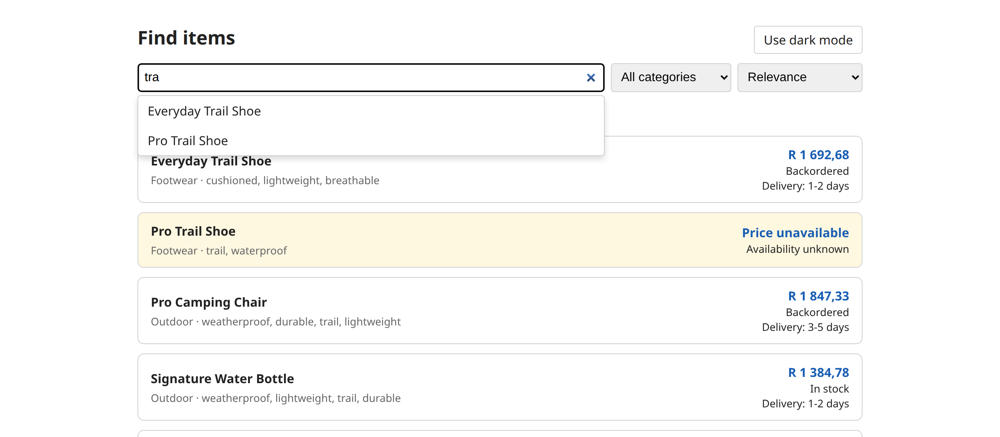
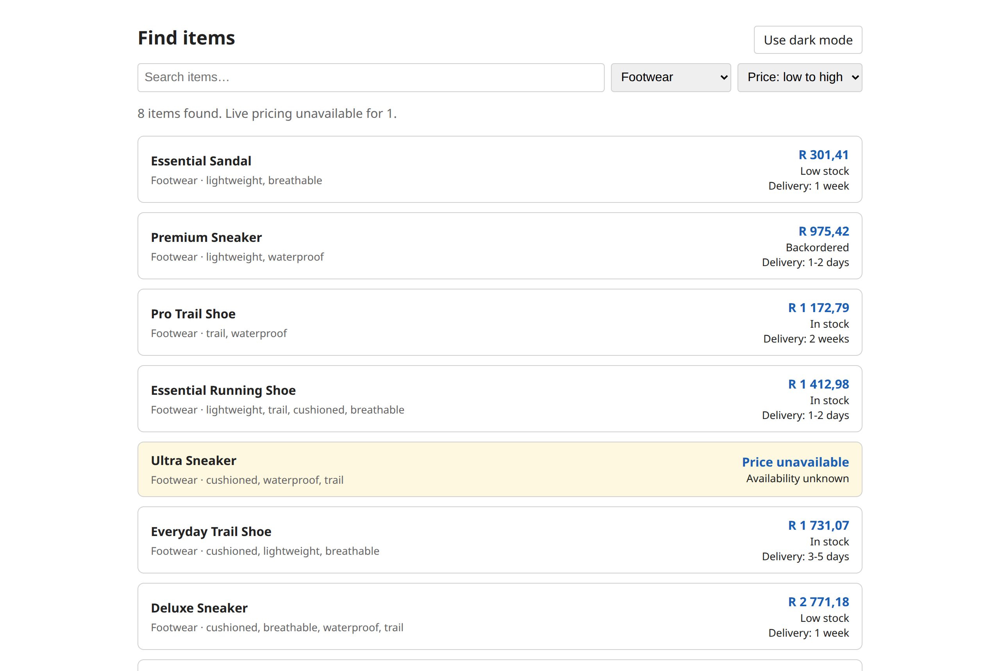

# Search & Discovery Mini App

A focused slice of a delivery app's customer search and discovery experience: free-text search over a local catalog, one category filter, one sort, and results enriched with live availability, price, and delivery estimate from a simulated upstream provider.

See `requirements.md` for the brief and `SOLUTION.md` for design decisions and trade-offs.
Full architecture, domain model, API contract, and decision records live in the
[OKF knowledge bundle](okf/index.md), browsable with `npm run okf:view`.

## Screenshots

Typeahead suggestions while typing, with ranked results underneath. The highlighted card is an
item whose live pricing call failed: it still shows, marked "Price unavailable".



Filtered to Footwear and sorted by price, with live price, stock and delivery estimates:



## Stack

TypeScript (strict), Node.js 24, Express 5, a hand-rolled vanilla TS client (no framework), Vite, Vitest, Playwright. See `AGENTS.md` for the full rundown.

## Prerequisites

- Node.js 24 (LTS)

## Setup

```bash
npm install
npm run seed   # generates data/catalog.seed.json (committed already, but regenerate if you like)
```

## Running locally

```bash
npm run dev
```

Starts the Express API on `http://localhost:3000` and the Vite dev server on `http://localhost:5173` (which proxies `/api` to the Express server). Open `http://localhost:5173`.

If either port is already in use on your machine, override them:

```bash
PORT=3001 VITE_PORT=5175 npm run dev
```

## Scripts

| Script                 | What it does                                                                                    |
| ---------------------- | ----------------------------------------------------------------------------------------------- |
| `npm run dev`          | Runs the API and client dev servers together                                                    |
| `npm run build`        | Type-checks everything, then builds the client to `dist/client`                                 |
| `npm start`            | Runs the API in production mode (serves the built client from `dist/client`; run `build` first) |
| `npm test`             | Runs the Vitest unit tests                                                                      |
| `npm run test:e2e`     | Runs the Playwright e2e tests (starts its own dev servers)                                      |
| `npm run typecheck`    | Type-checks server and client separately                                                        |
| `npm run format`       | Formats every file with Prettier                                                                |
| `npm run format:check` | Checks formatting without changing any file                                                     |
| `npm run seed`         | Regenerates `data/catalog.seed.json` (fixed seed, same output every run)                        |
| `npm run seed:random`  | Generates `data/catalog.random.json` (random seed, gitignored) for manual testing               |
| `npm run okf:validate` | Checks the `okf/` knowledge bundle against the OKF v0.2 spec                                    |
| `npm run okf:view`     | Validates and writes `okf/viz.html`, a browsable concept graph                                  |

To run the app against a different dataset, point `CATALOG_PATH` at it:

```bash
npm run seed:random
CATALOG_PATH=data/catalog.random.json npm run dev
```

## API

Base URL: `http://localhost:3000/api` (or wherever `PORT` points).

### `GET /api/search`

| Query param | Type                                   | Default     | Notes                                                                                                                                                                                                         |
| ----------- | -------------------------------------- | ----------- | ------------------------------------------------------------------------------------------------------------------------------------------------------------------------------------------------------------- |
| `q`         | string                                 | `""`        | Free-text query, matched against each word of item name, category, and tags. Words are OR'd; items matching more words rank higher. A query with no searchable words (e.g. `the`, `t`) applies no text filter |
| `category`  | string                                 | none        | Exact category match. See `GET /api/categories` for valid values                                                                                                                                              |
| `sort`      | `relevance` \| `price` \| `popularity` | `relevance` | `relevance` only has an effect when `q` is set. `price` sorts by `basePrice` (see `SOLUTION.md`)                                                                                                              |
| `page`      | positive integer                       | `1`         | 1-indexed. A page past the end serves the last page; check `page` in the response                                                                                                                             |
| `pageSize`  | positive integer                       | `12`        | Capped at 50                                                                                                                                                                                                  |

A repeated parameter, an unknown `sort`, or a `page` or `pageSize` that isn't a positive integer returns `400 BAD_REQUEST`. Unknown parameters are ignored.

Response:

```json
{
  "items": [
    {
      "id": "31285d63-9b22-40ba-97dc-9d31408e017e",
      "name": "Ultra Running Shoe",
      "category": "Footwear",
      "tags": ["cushioned", "breathable"],
      "basePopularity": 0,
      "basePrice": 2860.26,
      "price": 2723.98,
      "availability": "In stock",
      "deliveryEstimate": "1 week",
      "enrichmentFailed": false
    }
  ],
  "total": 2,
  "page": 1,
  "pageSize": 2
}
```

When the simulated upstream call for an item fails, that item has `enrichmentFailed: true` and `price`, `availability`, and `deliveryEstimate` are `null`. This is expected: the upstream provider has a variable latency and an ~8% failure rate per item, and the UI is built to show that item anyway rather than drop it. `availability` is one of `In stock`, `Low stock`, `Backordered`.

```bash
curl "http://localhost:3000/api/search?q=trail"
curl "http://localhost:3000/api/search?category=Footwear&sort=price&page=1&pageSize=5"
```

Errors (4xx/5xx) respond with:

```json
{
  "code": "BAD_REQUEST",
  "message": "sort must be one of: relevance, price, popularity"
}
```

Codes the API responds with:

| Code             | Status | When                                                                 |
| ---------------- | ------ | -------------------------------------------------------------------- |
| `BAD_REQUEST`    | 400    | Invalid query parameter                                              |
| `NOT_FOUND`      | 404    | Unmatched `/api/*` route                                             |
| `INTERNAL_ERROR` | 500    | Unexpected server bug (details are logged server-side, not returned) |

Upstream failures never produce an error response. The provider raises `UPSTREAM_ERROR` / `UPSTREAM_TIMEOUT` internally, and the search route turns those into a degraded item (see above). A search also stops its upstream calls if the client disconnects first, e.g. when the UI cancels a stale search.

```bash
curl "http://localhost:3000/api/search?sort=bogus"
# {"code":"BAD_REQUEST","message":"sort must be one of: relevance, price, popularity"}
curl "http://localhost:3000/api/search?page=abc"
# {"code":"BAD_REQUEST","message":"page must be a positive integer"}
```

### `GET /api/suggestions`

Typeahead suggestions for the search box: item names that hold a query word, or a word starting
with one. They're ranked by the same relevance scoring as `GET /api/search`, deduplicated, and
capped at 8. An item that matches only through a tag or category isn't suggested, because its
name wouldn't contain what was typed.

| Query param | Type   | Default | Notes                                                                                                              |
| ----------- | ------ | ------- | ------------------------------------------------------------------------------------------------------------------ |
| `q`         | string | `""`    | Free-text query, matched like `q` in `GET /api/search`. A missing or empty `q` returns an empty list, not an error |

A repeated `q` (`?q=a&q=b`) returns `400 BAD_REQUEST`, like the other endpoints.

Response:

```json
{
  "suggestions": ["Everyday Trail Shoe", "Pro Trail Shoe"]
}
```

Empty result (blank or missing `q`, or a query that matches nothing):

```json
{ "suggestions": [] }
```

```bash
curl "http://localhost:3000/api/suggestions?q=trail"
```

Suggestions never call the simulated upstream provider, so there is no enrichment to fail and
no `Server-Timing` header. That is what makes them cheap enough to fetch on every debounce tick.

### `GET /api/categories`

Returns the distinct category names in the catalog, for populating the filter control.

```bash
curl "http://localhost:3000/api/categories"
# ["Apparel","Electronics","Footwear","Home & Kitchen","Outdoor"]
```

### `GET /api/metrics`

In-memory request counters, reset when the server restarts.

```bash
curl "http://localhost:3000/api/metrics"
```

```json
{
  "since": "2026-09-14T10:00:00.000Z",
  "routes": {
    "GET /api/search": {
      "count": 3,
      "clientErrors": 1,
      "serverErrors": 0,
      "aborted": 0,
      "avgMs": 210.4,
      "maxMs": 398.2
    }
  },
  "enrichment": { "items": 24, "failed": 2 }
}
```

See `okf/app/api.md` for what each field means, and `okf/adr/0005-hand-rolled-request-metrics.md` for why.

## Instrumentation

Three ways to see what the server is doing, with no added dependencies:

1. **Terminal log**: `npm run dev` or `npm start` prints one line per `/api` request, e.g. `GET /api/search?q=shoe 200 312.4ms`.
2. **`GET /api/metrics`**: `curl http://localhost:3000/api/metrics` for the counters above.
3. **`Server-Timing` header**: open Chrome DevTools, run a search, and check Network → the `search` request → Timing. It shows `search` (catalog lookup) and `enrich` (upstream calls) as separate entries.

## Testing

- Unit tests (`server/test/`): the tokeniser, the inverted-index ranking, `searchCatalog`'s filter/sort/pagination, and the simulated upstream provider's success/failure/abort paths.
- API tests (`server/test/api.test.ts`): the real Express app on a random port. Covers query validation, JSON 404s, per-item degradation when every upstream call fails, and upstream calls being aborted when the client disconnects.
- Metrics tests (`server/test/metrics.test.ts`): request counting, the shared key for unmatched routes, the `Server-Timing` header, enrichment counts, aborted requests, and request logging.
- E2E tests (`e2e/`): free-text search, empty state, category filter, price sort, pagination (including keyboard focus), Back/Forward, and graceful degradation when enrichment fails for an item.

```bash
npm test
npm run test:e2e
```
