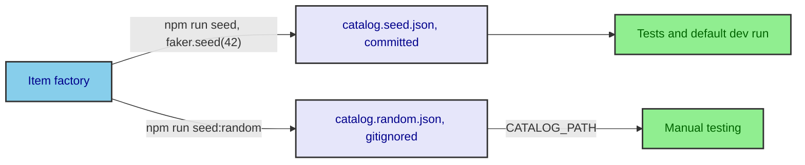

# ADR-0003: One catalog factory, two seeds

- **Status:** accepted
- **Date:** 2026-09-13
- **Deciders:** Jordan Hunt, with Claude Sonnet 5

## Context

Tests and the default dev run need the same data every time. But search tuned against one fixed
dataset can look right only because of that dataset's particular names and tags.

## Decision

We will generate the catalog with one `@faker-js/faker` factory in `scripts/generate-catalog.ts`,
run two ways. Both outputs hold 36 items of the same shape.

## Consequences

### Positive

- A fresh clone, `npm test`, and `npm run dev` all see the same catalog.
- `npm run seed:random`, then `CATALOG_PATH=data/catalog.random.json npm run dev`, tries
  search on data it wasn't tuned on.
- One factory defines the item shape, so the two datasets can't drift apart.

### Trade-offs

- Two dataset files. The random one is gitignored, so it's never mistaken for the fixture.

## Alternatives considered

| Option                   | Why rejected                                                                        |
| ------------------------ | ----------------------------------------------------------------------------------- |
| One fixed dataset        | Simpler, but search could end up tuned to that one dataset without anyone noticing. |
| Random data on every run | Tests would get different data each run, and bugs would be hard to reproduce.       |
