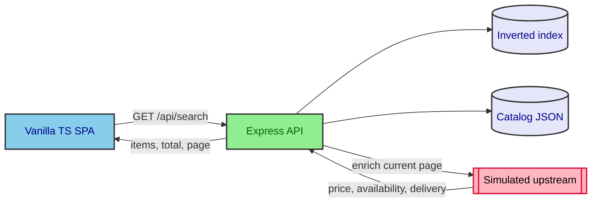

# Architecture

## Components

- **Client** (`client/src/`): `main.ts` owns state, debounced search, and URL sync. `api.ts`
  wraps `fetch` and returns a `Result<T>`. `components/` holds factory-function components;
  the results list matches cards to items by id and updates them inside a View Transition.
  See [ADR-0001](/adr/0001-vanilla-ts-client-over-svelte.md).
- **API** (`server/src/`): `routes/search.ts` validates params, calls `searchCatalog`
  ([Search & ranking](/app/search-ranking.md)), then enriches only the returned page.
  `upstream.ts` simulates the provider (80-400ms latency, 8% failure rate per call). `app.ts`
  wires the routes, a JSON 404, and the error middleware.
- **Data**: `data/catalog.seed.json` (36 items, 5 categories), loaded and indexed once at
  startup. `CATALOG_PATH` selects another file
  ([ADR-0003](/adr/0003-dual-seeded-and-random-catalog-generation.md)).
- **Shared contract**: `shared/api-types.ts`, imported by both sides
  ([Domain model](/app/domain-model.md)).

Enriching only the current page caps upstream calls at one page, however many items match. It
is also why price sort uses `basePrice` ([ADR-0002](/adr/0002-sort-by-base-price-not-live-price.md)).

## Cancellation

Only the latest search matters, so older ones stop at every layer:

1. **Client**: each search aborts the previous request's `AbortController`. A generation
   counter drops any response that still arrives late.
2. **Server**: if the response closes (`res.on("close")`) before it finished, the client has
   gone, so the route aborts its enrichment signal.
3. **Upstream**: `fetchEnrichment` takes an `AbortSignal`, like `fetch`, and rejects when it
   fires.

The same signal carries a 3-second limit for the whole page
(`AbortSignal.any([timeout, disconnected])`), so a slow provider can't hold up the response.

## Why the response waits for enrichment

`GET /api/search` sends nothing until the current page is enriched. The other option was to
send catalog results first and fill in price, availability, and delivery afterwards. Waiting
still meets the brief's "degrade gracefully rather than block on it", because:

- **A failure never blocks the list.** An item whose upstream call fails or times out comes
  back with `enrichmentFailed: true` and shows as "Price unavailable". The rest of the list
  renders as normal.
- **The wait is short and has a limit.** Every call on a page starts at once, so a page costs
  its slowest item (80-400ms), not the sum. The 3-second limit above returns anything slower
  as degraded.
- **The UI stays usable while it waits.** The last results stay on screen, dimmed, with a
  "Searching…" status. Typing or changing a control cancels the request and starts a new one.
- **It's simpler.** One request and one loading state per search. Filling prices in later
  needs a second request or a stream, plus a "loading price" state on every card.

Trade-off: results show up to about 0.4s later than catalog data alone could. If a real
provider were often slow, filling prices in later would be worth revisiting.

## Instrumentation

`metrics.ts` middleware, mounted at `/api`, counts every request per route and logs one line
per request in the terminal. `GET /api/metrics` returns the counts as JSON, and
`GET /api/search` carries a `Server-Timing` header split into catalog search time and
upstream enrichment time. See [ADR-0005](/adr/0005-hand-rolled-request-metrics.md) and the
[API doc](/app/api.md#get-apimetrics).

## Error handling

| Kind                                  | Handling                                                                                                                                                   |
| ------------------------------------- | ---------------------------------------------------------------------------------------------------------------------------------------------------------- |
| Upstream failure or timeout, per item | The item returns with `enrichmentFailed: true`, and the search succeeds.                                                                                   |
| Invalid query parameter               | Throws `AppError`. Express 5 passes it to the error middleware, which returns a JSON `ApiError` with status 400.                                           |
| Anything else (a bug)                 | Logged on the server. The client gets a generic `500 INTERNAL_ERROR`.                                                                                      |
| Failure seen by the client            | `apiFetch` returns an error result (`TIMEOUT`, `NETWORK_ERROR`, or the API's error) instead of throwing. Previous results stay visible, and Enter retries. |
