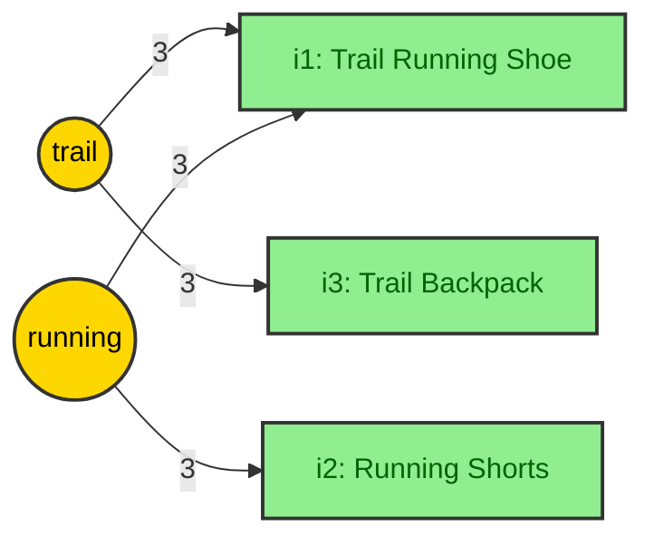
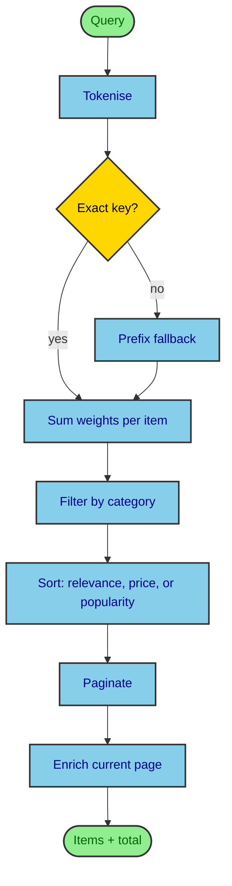

# Search & ranking

Search doesn't scan the catalog. At startup the server builds an inverted index: a map from
each word to the items containing it, weighted by the field the word came from.

## Indexed text

Each item is indexed by its `name`, `category`, and `tags`. The catalog generator gives each
category a small tag pool (Footwear: `trail`, `waterproof`, `lightweight`, and so on) and
picks 2-4 tags per item, so items in a category share words and ranking has something to tell
apart.

## Tokenising

One function splits item text into words at index time and the query at search time, so a
query word can always equal an index key:

```typescript
const STOPWORDS = new Set(["a", "an", "the", "and", "or", "for", "with", "of"]);

export function tokenise(text: string): string[] {
  return text
    .toLowerCase()
    .normalize("NFKD")
    .replace(/\p{M}/gu, "") // drop accent marks: "crème" -> "creme"
    .replace(/[^\p{L}\p{N}\s]/gu, " ") // punctuation splits words: "moisture-wicking" -> "moisture", "wicking"
    .split(/\s+/)
    .filter((token) => token.length > 1 && !STOPWORDS.has(token));
}
```

Accent marks go before punctuation does. Otherwise each mark would become a space and split
the word ("cre me").

## The index

```typescript
type InvertedIndex = Map<string, Map<string, number>>; // token -> (itemId -> field weight)

const FIELD_WEIGHT = { name: 3, category: 2, tag: 1 } as const;

function addToken(
  index: InvertedIndex,
  token: string,
  itemId: string,
  weight: number,
): void {
  const postings = index.get(token) ?? new Map<string, number>();
  postings.set(itemId, Math.max(postings.get(itemId) ?? 0, weight));
  index.set(token, postings);
}

export function buildIndex(items: CatalogItem[]): InvertedIndex {
  const index: InvertedIndex = new Map();
  for (const item of items) {
    for (const token of tokenise(item.name))
      addToken(index, token, item.id, FIELD_WEIGHT.name);
    for (const token of tokenise(item.category))
      addToken(index, token, item.id, FIELD_WEIGHT.category);
    for (const token of item.tags.flatMap(tokenise))
      addToken(index, token, item.id, FIELD_WEIGHT.tag);
  }
  return index;
}
```

Weights are stored at build time, so a query is only lookups and additions. `Math.max` counts a
word found in both the name and a tag once, at the higher weight. The seed catalog has 62
distinct words.

## Scoring

```typescript
export function scoreCandidates(
  query: string,
  index: InvertedIndex,
): Map<string, number> | null {
  const tokens = tokenise(query);
  if (tokens.length === 0) return null;

  // Each index key counts once per query. Exact words claim their keys first,
  // then longer words before shorter ones.
  const words = [...new Set(tokens)].sort((a, b) => b.length - a.length);
  const counted = new Set(words.filter((word) => index.has(word)));

  const scores = new Map<string, number>(); // itemId -> score
  for (const word of words) {
    const postings = index.get(word) ?? matchByPrefix(index, word, counted);
    for (const [itemId, weight] of postings) {
      scores.set(itemId, (scores.get(itemId) ?? 0) + weight);
    }
  }
  return scores;
}

function matchByPrefix(
  index: InvertedIndex,
  token: string,
  counted: Set<string>,
): Map<string, number> {
  const merged = new Map<string, number>();
  for (const [key, postings] of index) {
    if (!key.startsWith(token) || counted.has(key)) continue;
    counted.add(key);
    for (const [itemId, weight] of postings) {
      merged.set(itemId, Math.max(merged.get(itemId) ?? 0, weight));
    }
  }
  return merged;
}
```

- **Prefix fallback**: a query word with no exact key matches every key that starts with it,
  so "runn" finds "running" while the user types. It checks every key, which is cheap with 62.
- **Each key counts once**: a repeated word ("trail trail") is scored once, and a prefix word
  skips keys another query word already matched, so "runn running" scores "running" once.
  Otherwise repeating a word would push an item above one that matches more of the query.
  Longer words claim keys first, so "sho shor" and "shor sho" score the same.
- **No text filter**: a query with no searchable words (`the`, or one letter) returns `null`,
  meaning "don't filter", so the first keystroke doesn't flash "No items match". A real query
  with no matches returns an empty map, which shows the empty state.
- **Ties** keep catalog order, because `Array.prototype.sort` is stable, so a query always
  paginates the same way.

**Known limits, fine at this size:** query words are OR'd, not AND'd. Word forms aren't
matched: `shoe` reaches `shoes` only through the prefix fallback, and `shoes` never matches
`shoe`. An exact key skips the fallback, so if both `shoe` and `shoes` were keys, `shoe`
wouldn't match `shoes`.

## Worked example

| Item | Name               | Category | Tags               |
| ---- | ------------------ | -------- | ------------------ |
| i1   | Trail Running Shoe | Footwear | trail, lightweight |
| i2   | Running Shorts     | Apparel  | breathable         |
| i3   | Trail Backpack     | Outdoor  | trail, lightweight |

The query `"trail running"` splits into `["trail", "running"]`, which find these index entries:



Adding up per item gives **i1 = 6**, i2 = 3, i3 = 3. i1's `trail` tag adds nothing, because
`Math.max` kept the name's weight. "Trail Running Shoe", the only item both words describe,
ranks first. `server/test/search.test.ts` checks these scores.

## Request flow



Everything before enrichment runs in memory. Only the returned page is enriched
([Architecture](/app/architecture.md)), which is why price sort uses `basePrice`
([ADR-0002](/adr/0002-sort-by-base-price-not-live-price.md)).
